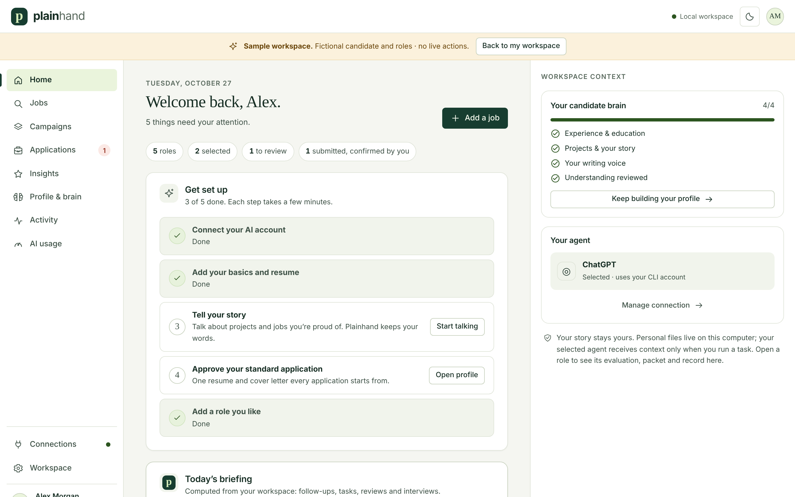
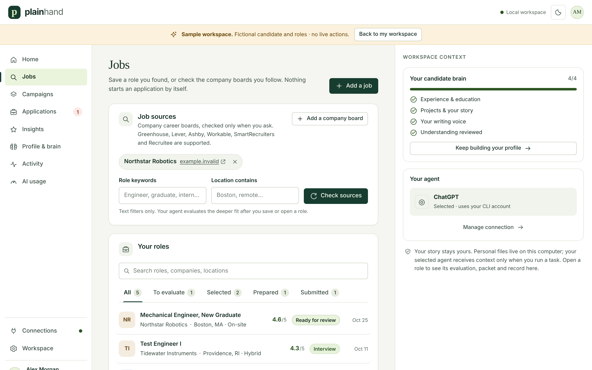
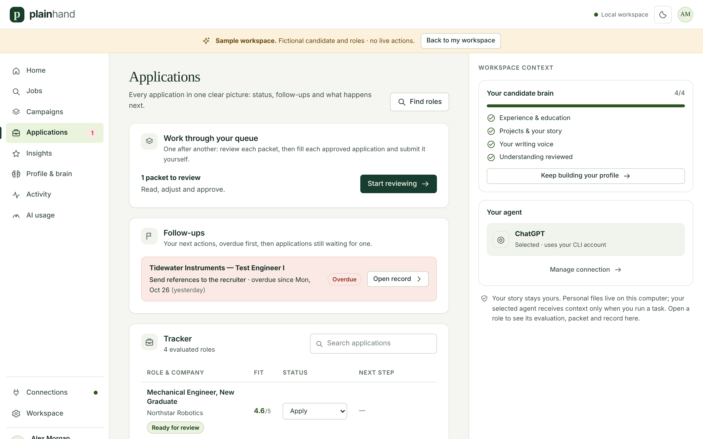

<div align="center">


# Plainhand

**Your job applications, in your own words.**
A job-application assistant that runs on your computer with your own AI account. You review and submit every application.

[](https://github.com/akhan157/plainhand/releases/latest)
[](https://github.com/akhan157/plainhand/actions/workflows/test.yml)
[](https://github.com/akhan157/plainhand/actions/workflows/installer-check.yml)
[](LICENSE)


[Quick start](#quick-start) · [Install](docs/INSTALL.md) · [User guide](docs/USER-GUIDE.md) · [Security](SECURITY.md) · [Changelog](CHANGELOG.md)

<picture>
  <source media="(prefers-color-scheme: dark)" srcset="docs/images/home-dark.png">
  
</picture>

</div>

Plainhand is a job-application assistant that runs on your own computer and uses
your own AI subscription (Claude, ChatGPT or Gemini/Antigravity). You talk to
it about your experience; it builds a profile of you in your own words, writes
a standard resume and cover letter you approve once, tailors them for each
role, fills application forms on employer sites, and lists anything it
couldn't answer. **You review and submit every application yourself.**

## Quick start

With [Node.js 22 or newer](https://nodejs.org), one command downloads,
sets up and starts Plainhand, then opens it in your browser:

```sh
curl -fsSL https://raw.githubusercontent.com/akhan157/Plainhand/main/install.sh | sh
```

On Windows PowerShell:

```powershell
irm https://raw.githubusercontent.com/akhan157/Plainhand/main/install.ps1 | iex
```

The first run installs Chromium and opens Plainhand. Your workspace is kept in
`~/.plainhand/workspace` (`%USERPROFILE%\.plainhand\workspace` with PowerShell),
separate from the downloaded code. The installer creates a `plainhand` command
(macOS/Linux: `~/.local/bin`; Windows: `%USERPROFILE%\.plainhand\bin`, added to
your user PATH). Run `plainhand --port 3211` if 3210 is busy,
`plainhand --data-root /path/to/workspace` for another folder, or
`plainhand --check` to see what is installed without starting. Step-by-step help
is in [docs/INSTALL.md](docs/INSTALL.md).

## What it does

- **A profile that sounds like you.** Built by conversation and from a few
  samples of your writing. Every claim it makes is traced to something you
  said or provided.
- **Not too modest, not overstated.** Each line is graded against your
  evidence: undersold, balanced, stretched or unsupported. It learns where you
  draw the line from your choices. Titles, employers, dates and degrees are
  always exact, and nothing you can't back up is used.
- **Your format, no AI writing.** Plainhand reads the layout of your own
  resume PDF (fonts, margins, headings, section order, dates, bullets) and
  renders every resume and cover letter in it. Every line it writes goes
  through a humanizer pass ([blader/humanizer](https://github.com/blader/humanizer))
  that removes AI writing patterns without changing a fact or number.
- **Less tedium.** One standard application, tailored per role; "make it
  shorter" or "lead with the pump project" revises it; queues let you review
  and send several in a row.
- **Forms filled, gaps flagged.** On Greenhouse, Lever, Ashby and
  employers' own careers sites it fills what it can from your approved packet and profile,
  uploads your resume and cover letter, and shows a pre-submit list of what's
  filled, what needs you and what to double-check.
- **Your data stays with you.** Everything is stored in your workspace:
  `~/.plainhand` with the one-command install, or the checkout folder in a
  manual install. The AI provider sees only what a task needs, and you can
  exclude any source. An optional Vercel remote view publishes a read-only
  copy only if you enable it.

## A look around

| Jobs, scored for fit with the evidence | Applications, from packet to submitted |
| --- | --- |
|  |  |

Screenshots use the built-in sample workspace (**Take a look around** on Home). The candidate and roles are fictional.

## Job sites

| Where the application is | What Plainhand does |
| --- | --- |
| Greenhouse, Lever, Ashby | Reads the form, fills what your approved packet and profile cover, uploads your resume and cover letter, and lists what's left for you. |
| Workday | Opens the application and stops at Workday's sign-in. Sign in or create your account in the application browser, then Plainhand reads each step. |
| A company's own careers site | Works on the employer's own site, including Greenhouse forms embedded in it. If the application moves to a site Plainhand doesn't support, it says so and you finish by hand. |
| LinkedIn, Indeed and other job boards | Never opened in Plainhand's browser, because their terms prohibit automation. Save the posting and give Plainhand the employer's application link. |

If a site shows a captcha or asks for a code, Plainhand pauses until you deal
with it. On 5 November 2026 the form reader was checked read-only on live
postings at Figma, Airbnb, Spotify, Palantir, Ramp, Linear, NVIDIA and
Salesforce; nothing was typed or submitted. Details are in
[Verification](docs/VERIFICATION-MATRIX.md).

## What you need

- A Mac, Windows or Linux computer with a desktop (the application browser
  opens on screen).
- [Node.js 22 or newer](https://nodejs.org).
- An AI account: Claude, ChatGPT or Google Antigravity. You do not need to
  install or configure an AI tool yourself; **Connections** in Plainhand sets
  up the connector and opens the sign-in in your browser. Your plan's usage
  limits apply.

## Manual install (development checkout)

For working on Plainhand itself, or if you prefer a local clone:

```bash
git clone https://github.com/akhan157/plainhand.git
cd plainhand
npm run setup     # checks your computer and installs what's needed
npm start
```

Open **http://127.0.0.1:3210** (use that exact address). Your data stays in the
checkout. Step-by-step help for each operating system is in
[docs/INSTALL.md](docs/INSTALL.md).

## First hour

1. **Connections:** pick your AI account, follow its three steps and press **Check and use**.
2. **Profile & brain:** paste your resume, then talk to Plainhand about a
   project or job you're proud of. Add two or three things you've written.
   Review "How your agent sees you" and approve it if it's right.
3. **Your standard application:** have Plainhand write it, read it, ask for
   changes, and approve it.
4. **Jobs:** paste a job link (company career pages, Greenhouse, Lever,
   Ashby, Workday… or a LinkedIn/Indeed posting plus the employer's
   application link). Evaluate it, choose it, prepare the application.
5. **Apply:** review the packet, approve it, open the application, let
   Plainhand fill it, check the pre-submit list, and submit it yourself on
   the employer's site. Then tell Plainhand you submitted.

The full walkthrough is in [docs/USER-GUIDE.md](docs/USER-GUIDE.md). Prefer to
look first? **Take a look around** on the home screen opens a sample workspace.

## What Plainhand never does

- Submit an application, press a final submit button, or mark something
  applied without your confirmation.
- Claim anything your sources don't support, or change an official title,
  employer, date, degree or seniority.
- Answer work authorization, compensation, demographic or legal questions for
  you.
- Open LinkedIn, Indeed or other job boards in its browser (their terms
  prohibit automation). Save the posting and give it the employer's link.
- Send your data anywhere by default. Only the AI provider sees a task's
  context; the optional Vercel remote view uploads a password-protected
  read-only snapshot, and only when you turn it on.

## Help and docs

- [Install guide](docs/INSTALL.md) · [User guide](docs/USER-GUIDE.md)
- [Browser app reference](docs/PLAINHAND-BROWSER-APP.md) (features, limits, data files, optional remote view)
- [Use Plainhand from your own agent (MCP)](docs/MCP.md)
- [What Plainhand measures](docs/METRICS-INVENTORY.md) · [Verification](docs/VERIFICATION-MATRIX.md)
- [Changelog](CHANGELOG.md)

## Credits and license

Plainhand builds on [career-ops](https://github.com/santifer/career-ops) by
Santiago Fernández de Valderrama (MIT). The career-ops name and brand belong
to its maintainer (see [TRADEMARK.md](TRADEMARK.md)); its original README is
kept in [docs/career-ops](docs/career-ops/README.md). The career-ops
command-line tools still ship in this repository for advanced use. Plainhand is
MIT-licensed ([LICENSE](LICENSE)).
